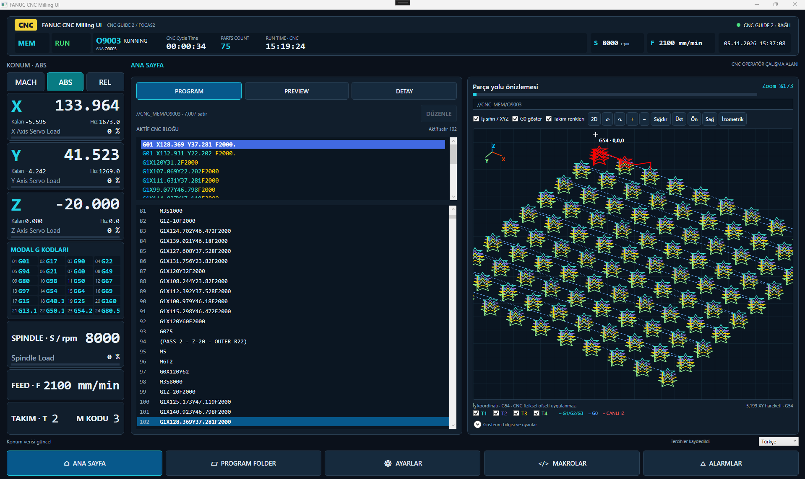
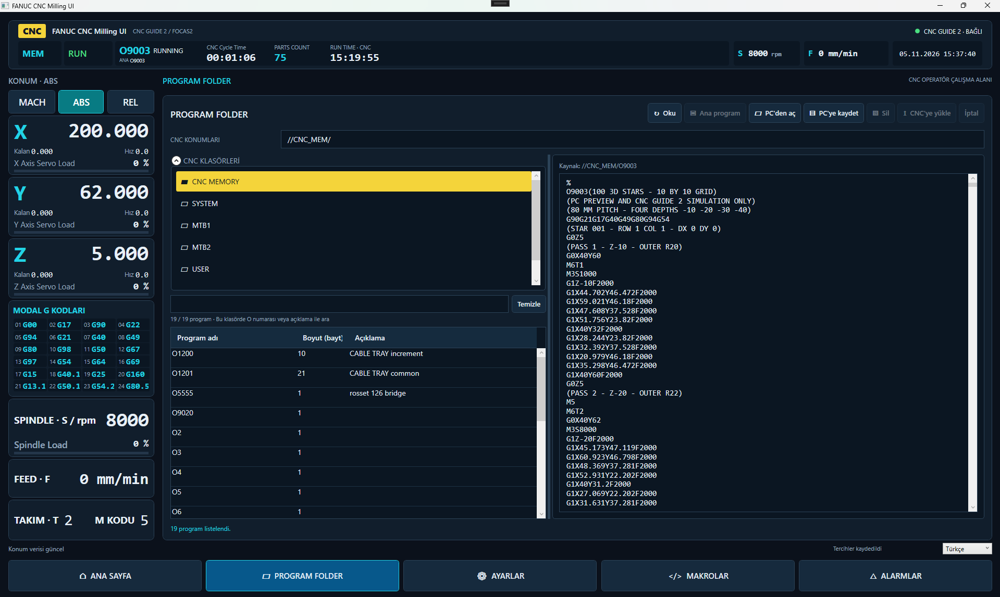
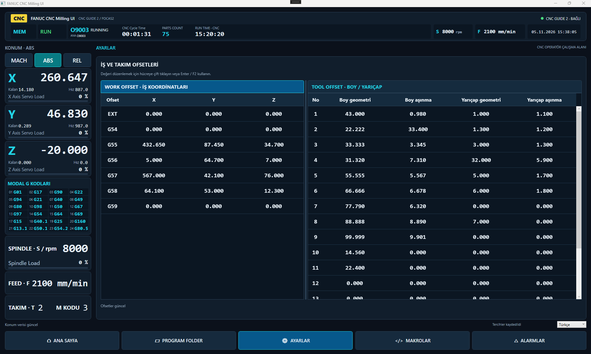
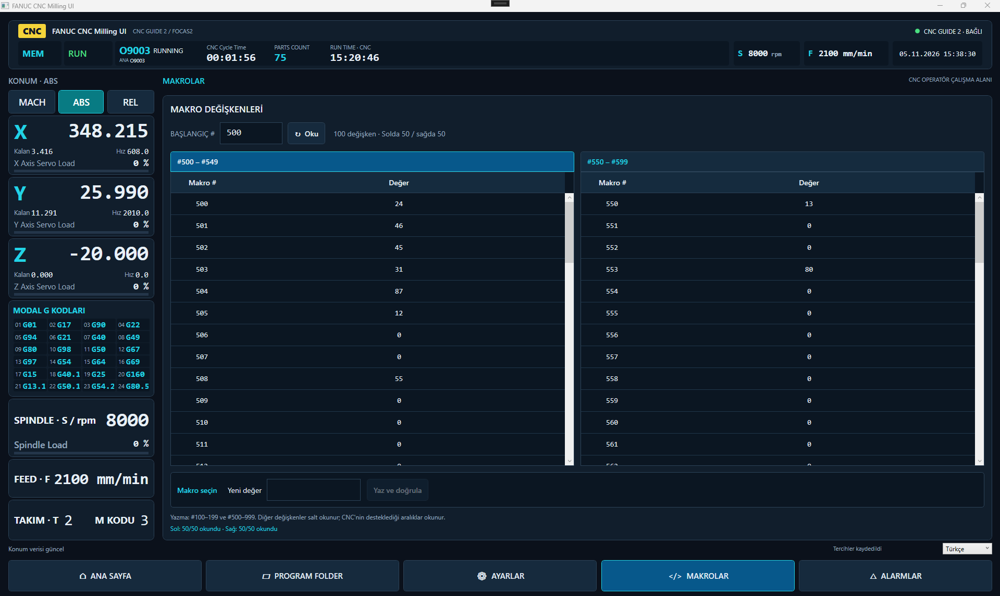
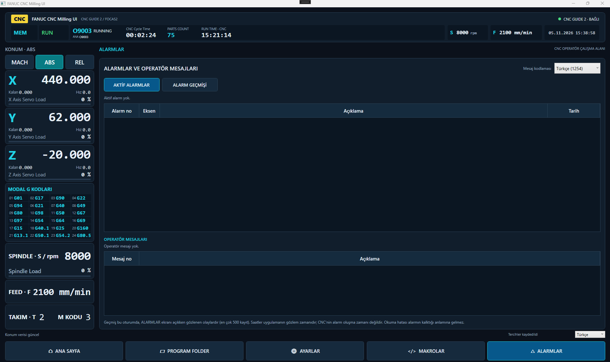

# FANUC CNC Milling UI

**A custom CNC operator interface built with C# and WPF.**

Live CNC monitoring · G-code editing · Interactive 2D/3D toolpaths

[Türkçe](README.tr.md) · [YouTube](https://www.youtube.com/@AutomationFusion) · [Developer](https://github.com/erkkmahh)

*The complete application during a CNC Guide 2 session: live coordinates and counters, synchronized G-code highlighting, and a 100-star 3D toolpath with tool colors and a red live trace.*

## About the project

FANUC CNC Milling UI brings program monitoring, file management, milling offsets, macro variables and alarms into a dark industrial operator interface. The application is developed using C# / .NET 8 / WPF and communicates through FANUC FOCAS2.

The current development and hands-on testing environment is **CNC Guide 2**. This repository presents the application and its behavior; **application source code and binaries are not included**.

## Feature highlights

| Area | What you can do |
|---|---|
| **Live dashboard** | Monitor MACH / ABS / REL coordinates, available axis/spindle loads, feed, spindle speed and modal G codes. |
| **Program monitoring** | Follow confirmed execution blocks, view CNC cycle/operating counters and inspect a line-based progress estimate. Ambiguous execution positions are not guessed. |
| **2D / 3D toolpaths** | Orbit, zoom, pan and select top/front/right/isometric views. Inspect the programmed work origin, toggle rapid moves and show/hide individual tools. |
| **Tool colors** | Separate cutting paths by the tool activated with M6; keep the live CNC trace distinct in red. |
| **PC G-code editor** | Edit a local draft with syntax colors, physical line numbers, search/replace, undo/redo and delayed preview updates. Save to a PC file. |
| **Program Folder** | Browse CNC folders, filter the loaded list by program name or description, read programs and use separate transfer operations. |
| **Milling offsets** | View and edit work offsets and tool length/radius geometry and wear values, with write/read-back checks. |
| **Macro variables** | Read two 50-row tables and write eligible common variables with read-back verification. |
| **Alarms and messages** | Read active alarms and operator messages; inspect session-based alarm observation history. |
| **Program summary** | Inspect calculated XYZ bounds, deepest known Z, tools and programmed F/S ranges in the DETAY tab. |

## Screen gallery

These are unaltered screenshots from the running application connected to CNC Guide 2. The main workspace is shown above; the following pages share its fixed status bar, coordinate panel and navigation.

### Program Folder

Browse CNC folders and programs on the left, inspect the selected program on the right, and filter the loaded list by program number or description. PC file operations and CNC transfer actions remain separate.

### Work and tool offsets

Work coordinates (EXT and G54–G59) sit alongside milling tool length/radius geometry and wear values.

### Macro variables

Read a chosen starting range into two 50-row tables. The local selection and value-entry area is below the tables; writes are subject to CNC-state and supported-range checks.

### Alarms and operator messages

Separate tables show active alarms and operator messages, with another tab for session observation history. This capture shows the normal state with no active alarms or operator messages.

## A workspace built around the operator

- A fixed top bar keeps connection, mode, execution state, program and production counters visible.
- A fixed coordinate panel provides axis positions, available loads and 24 modal G-code groups.
- **PROGRAM / PREVIEW / DETAY** tabs share the same toolpath viewer.
- Five bottom softkeys navigate between the main workspace, Program Folder, offsets, macros and alarms.

The application UI is currently primarily Turkish. This page describes the interface in English; see the [Turkish overview](README.tr.md) for the matching screen terminology.

## Editing without changing the CNC program

The main-workspace editor works on a **PC draft**. Saving writes a local file; it does not send the draft to the CNC. Uploading remains a separate operation in Program Folder.

Editing is disabled while the CNC is running or in HOLD, or when the required machine state cannot be confirmed. Draft preview geometry is kept separate from the live CNC trace. Unsaved changes require a decision before leaving the editor.

## Large-program demonstration

The development demo contains **100 stars in a 10 × 10 grid**, each with four depth passes:

| Pass | Tool | Z depth |
|---|---|---:|
| 1 | T1 | −10 mm |
| 2 | T2 | −20 mm |
| 3 | T3 | −30 mm |
| 4 | T4 | −40 mm |

The example contains **7,007 source lines and 5,199 parsed moves**. It is used to exercise loading, execution tracking, tool visibility and 3D navigation. This is a development example, not a guaranteed performance specification or a machining recipe.

## Demo video

A dedicated walkthrough will be added after recording. Follow **[AutomationFusion on YouTube](https://www.youtube.com/@AutomationFusion)** for project demonstrations.

## Current scope

| Item | Status |
|---|---|
| Windows / .NET 8 / WPF / x86 | Current application platform |
| CNC Guide 2 | Development and manual test environment |
| Real CNC through HSSB / Ethernet | Not validated as a supported release in this showcase |
| Source code | Private; not published here |
| Application download | Not offered in this repository at present |

The viewer displays the supported **nominal programmed toolpath**, not material removal or collision simulation. Physical CNC work-offset values and tool compensation are not applied to the displayed geometry. Unsupported or unresolved constructs can result in a partial preview with warnings.

Progress is a line-based estimate, not a time estimate. Alarm history records observations made during the application session while the alarm screen is open; it is not a download of the controller's complete historical alarm log.

## Developer

Created by **[erkkmahh](https://github.com/erkkmahh)** · Videos: **[AutomationFusion](https://www.youtube.com/@AutomationFusion)**

This is an independent project and is not affiliated with, endorsed by or an official product of FANUC. FANUC and CNC Guide are trademarks of their respective owner. No FANUC libraries are distributed in this repository.
