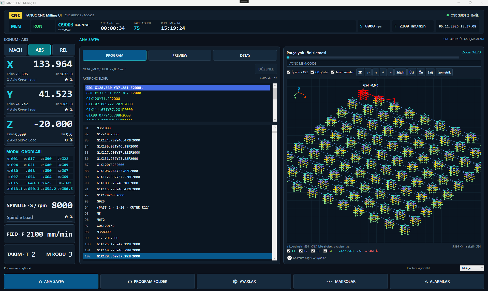
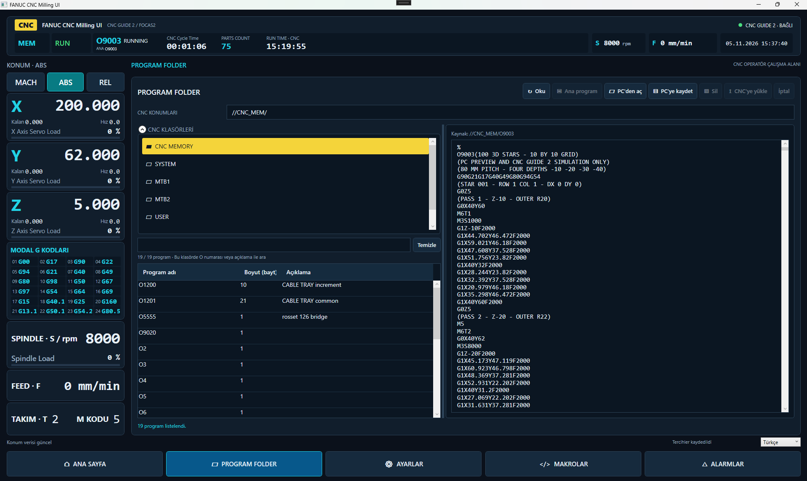
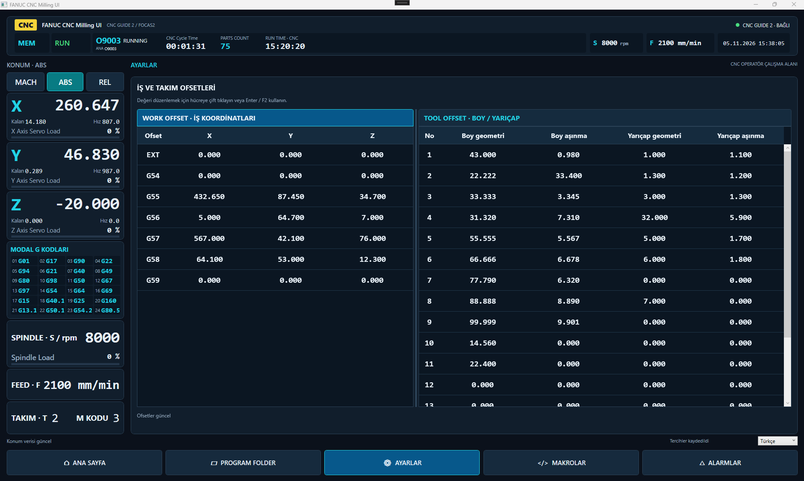
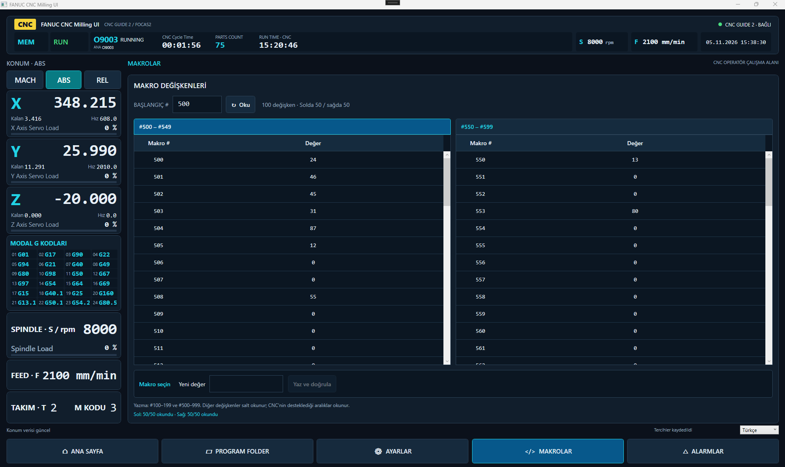
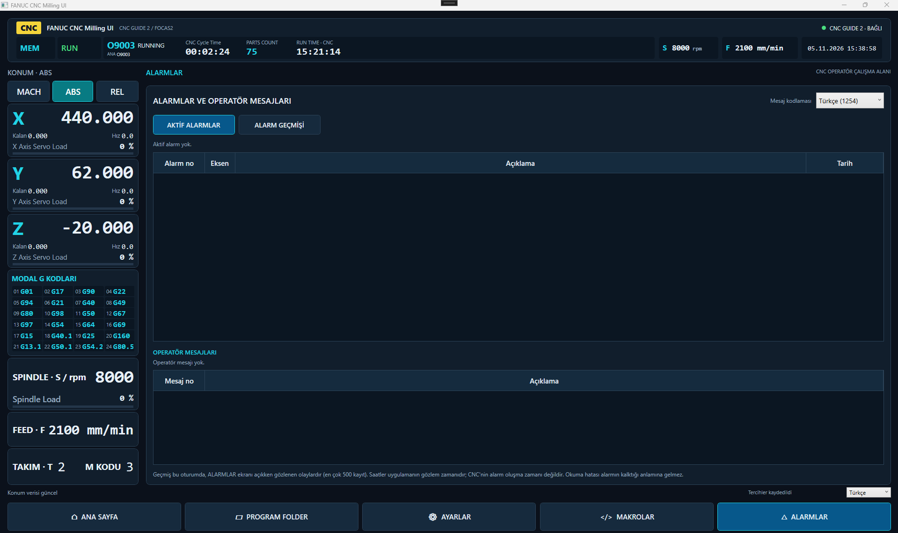

# FANUC CNC Milling UI

**C# ve WPF ile geliştirilen özel CNC operatör arayüzü.**

Canlı CNC takibi · G-code editörü · Etkileşimli 2D/3D takım yolu

[English](README.md) · [YouTube](https://www.youtube.com/@AutomationFusion) · [Geliştirici](https://github.com/erkkmahh)

*CNC Guide 2 oturumundan uygulamanın tam ekranı: canlı koordinatlar ve sayaçlar, senkron G-code vurgusu, takım renkleri ve kırmızı canlı izle 100 yıldızlık 3D takım yolu.*

## Proje hakkında

FANUC CNC Milling UI; program takibi, dosya yönetimi, freze ofsetleri, makro değişkenleri ve alarmları koyu endüstriyel bir arayüzde toplar. C# / .NET 8 / WPF ile geliştirilir ve FANUC FOCAS2 üzerinden haberleşir.

Mevcut geliştirme ve kullanıcı testleri **CNC Guide 2** üzerinde yapılmaktadır. Bu depo uygulamayı tanıtmak içindir; **kaynak kod ve uygulama dosyaları içermez**.

## Özellikler

| Alan | İşlev |
|---|---|
| **Canlı göstergeler** | MACH / ABS / REL koordinatları, okunabilen eksen/spindle yükleri, feed, spindle devri ve modal G kodları. |
| **Program takibi** | Doğrulanmış aktif blok vurgusu, CNC sayaçları ve satır bazlı tahmini ilerleme. Belirsiz konumlarda rastgele satır seçilmez. |
| **2D / 3D önizleme** | Döndürme, zoom, pan; Üst / Ön / Sağ / İzometrik kamera açıları; program sıfırı ve XYZ referansı. |
| **Takım görünürlüğü** | M6 ile aktifleşen takıma göre renkler, ayrı takım kutuları ve G0 göster/gizle. Kırmızı canlı iz ayrı tutulur. |
| **PC editörü** | Renklendirme, fiziksel satır numaraları, arama/değiştirme, geri/ileri alma, gecikmeli önizleme ve PC'ye kaydetme. |
| **PROGRAM FOLDER** | CNC klasörlerinde gezinme, program adı/açıklama araması, program okuma ve ayrı transfer işlemleri. |
| **Freze ofsetleri** | İş ofsetleri; takım boy/yarıçap geometrisi ve aşınma değerleri; yazma sonrası geri okuma kontrolü. |
| **Makrolar** | İki adet 50 satırlı tablo; uygun ortak değişkenlerde yazma ve geri okuma doğrulaması. |
| **Alarmlar** | Aktif alarmlar, operatör mesajları ve oturum boyunca gözlenen alarm geçmişi. |
| **Program özeti** | DETAY sekmesinde hesaplanan XYZ sınırları, en derin bilinen Z, takımlar ve programlanan F/S aralıkları. |

## Ekran galerisi

Görseller, CNC Guide 2'ye bağlı çalışan uygulamadan alınmış ve değiştirilmeden kullanılmıştır. Ana ekran yukarıdadır; diğer sayfalarda da üst durum çubuğu, sol koordinat paneli ve alt navigasyon korunur.

### PROGRAM FOLDER

Solda CNC klasörleri ve program listesi, sağda seçilen programın içeriği bulunur. Okunmuş liste O numarası veya açıklama ile filtrelenir. PC dosya işlemleri ve CNC'ye aktarım ayrı komutlardır.

### İş ve takım ofsetleri

Solda EXT ve G54–G59 iş koordinatları; sağda freze takımlarının boy/yarıçap geometrisi ve aşınma değerleri birlikte gösterilir.

### Makro değişkenleri

Seçilen başlangıç adresinden itibaren solda 50, sağda 50 değişken okunur. Tabloların altında değişken seçimi ve yeni değer girişi bulunur. Yazma işlemi CNC durumu ve desteklenen aralık kontrollerine bağlıdır.

### Alarmlar ve operatör mesajları

Aktif alarmlar ve operatör mesajları ayrı tablolarda gösterilir; oturumda gözlenen alarm geçmişi ayrı sekmededir. Bu görüntüde aktif alarm ve operatör mesajı olmayan normal durum gösterilmektedir.

## Ekran düzeni

Üstte bağlantı, mod, çalışma durumu, program ve sayaçlar; solda koordinatlar, yükler ve 24 modal G-code grubu sabittir. ANA SAYFA içindeki **PROGRAM / PREVIEW / DETAY** sekmeleri sağdaki ortak takım yolu görünümünü kullanır.

Alttaki beş softkey ile **ANA SAYFA / PROGRAM FOLDER / AYARLAR / MAKROLAR / ALARMLAR** arasında geçiş yapılır.

## Editör yalnız PC tarafında çalışır

Editördeki değişiklikler bağımsız bir PC taslağına uygulanır. **KAYDET, CNC'ye göndermez.** CNC'ye yükleme PROGRAM FOLDER içindeki ayrı işlemle yapılır.

CNC çalışırken, HOLD durumundayken veya gerekli durum bilgisi doğrulanamıyorken düzenleme kilitlidir. Taslak önizlemesi canlı CNC iziyle karıştırılmaz. Kaydedilmemiş değişikliklerle çıkışta kullanıcıya sorulur.

## Büyük program örneği

Geliştirme örneğinde **10 × 10 düzende 100 yıldız**, her yıldızda dört paso vardır:

| Paso | Takım | Derinlik |
|---|---|---:|
| 1 | T1 | −10 mm |
| 2 | T2 | −20 mm |
| 3 | T3 | −30 mm |
| 4 | T4 | −40 mm |

Dosya **7.007 satır ve 5.199 hesaplanan hareket** içerir. Yükleme, aktif satır takibi, takım filtreleri ve 3D kamera denemelerinde kullanılır. Bu sayılar performans garantisi veya fiziksel tezgâh için işleme reçetesi değildir.

## Video

Tanıtım videosu çekildikten sonra buraya eklenecek. Geliştirme videoları için **[AutomationFusion YouTube kanalını](https://www.youtube.com/@AutomationFusion)** takip edebilirsiniz.

## Mevcut durum ve sınırlar

| Konu | Durum |
|---|---|
| Platform | Windows / .NET 8 / WPF / x86 |
| Geliştirme ve canlı kullanıcı testleri | CNC Guide 2 |
| Gerçek CNC'de HSSB / Ethernet | Bu tanıtım için doğrulanmış destek iddiası yok |
| Kaynak kod | Gizli; bu depoda paylaşılmıyor |
| Uygulama indirme | Şu anda sunulmuyor |

Önizleme desteklenen **nominal program yolunu** çizer; malzeme kaldırma veya çarpışma simülasyonu değildir. CNC'nin fiziksel iş ofsetleri ve takım telafisi geometriye uygulanmaz. Desteklenmeyen ifadelerde uyarılı/kısmi çizim oluşabilir.

İlerleme satır bazlı tahmindir; kalan süre hesabı değildir. Alarm geçmişi, ALARMLAR ekranı açıkken bu uygulama oturumunda gözlenen kayıtlardır; CNC'nin tüm geçmiş alarm arşivi değildir.

## Geliştirici

**[erkkmahh](https://github.com/erkkmahh)** · **[AutomationFusion / YouTube](https://www.youtube.com/@AutomationFusion)**

Bağımsız bir projedir; FANUC'un resmî ürünü değildir ve FANUC ile bağlılık veya onay ilişkisi iddia etmez. FANUC ve CNC Guide adları ilgili hak sahibine aittir. Bu depoda FANUC kütüphaneleri dağıtılmaz.
